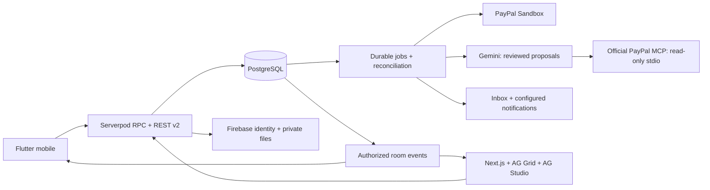

<p align="center"></p>
<h1 align="center">Raysto</h1>
<p align="center"><strong>Good company. Thoughtful ordering. A clearer bill.</strong></p>
<p align="center">Flutter mobile · Serverpod + PostgreSQL · Firebase · Gemini · PayPal Sandbox</p>
<p align="center"><a href="docs/reviewer-guide.md">Reviewer guide</a> · <a href="docs/getting-started.md">Run locally</a> · <a href="docs/project-status.md">What works today</a> · <a href="docs/conversation-roadmap.md">What's next</a></p>

Raysto brings restaurant discovery, ordering, table service and shared bills into one mobile experience. Diners review their choices; restaurant teams manage the same server-owned orders; AI suggests changes that people approve.

Built for the [PayPal AI Hackathon](https://paypalaihackathon.devpost.com/). Native mobile and the [restaurant console](https://ops.rays.to/ops) share PostgreSQL records through one backend. Visit conversations connect diners and their assigned waiter. Gemini uses authorized tools to propose an order or a payer's exact share; people approve consequential actions. The offline demo remains explicitly isolated.

## A place at the table

<p align="center">
  
  
  
</p>

Actual Flutter widget renders with illustrative fixtures. Screenshots demonstrate the interface, not a completed payment or live restaurant partnership. [Design and motion](docs/mobile-art-direction.md) · [Asset credits](docs/assets.md)

[Connected manager assistant and AG Studio](docs/screenshots/story/operations-assistant.png) · [Shared order and room](docs/screenshots/story/operations-connected.png). These hosted browser captures show explicitly labelled QA records; the bill is still unpaid.

## Explore the project

| Experience | Current scope |
| --- | --- |
| **Diners** | Discovery, menus, baskets and quotes, dine-in visits, service requests, reservations, pickup/delivery, shared bills and history. |
| **Restaurant teams** | Restaurant/menu management, tables, kitchen tickets, couriers, invitations, reports and support. Permissions come from PostgreSQL memberships. |
| **Reviewed AI** | Gemini menu imports and conversation tools, shared preferences, authoritative basket quotes and exact payment proposals. Approval and execution are separate. |
| **Payments** | Server-side PayPal Sandbox checkout, allocations, reconciliation and refund source. Complete buyer approval/capture/refund acceptance remains a separate gate. |
| **Connected operations** | Firebase sign-in, table map, AG Grid, AG Studio custom widgets/harness, room history, shared attention filters and saved layouts. `/ops` uses the real backend. |

**Status: integration candidate.** Android `0.11.5+2014` is built. Rooms, real Gemini basket/share proposals, Sandbox approval handoffs and real order reads through official PayPal MCP have been observed. Grouped mobile activity, assistant error recovery and console selection recovery are implemented. Google is currently returning capacity errors; complete conversational MCP acceptance, buyer capture/refund, the pilot and physical-device acceptance remain release gates. [October 27 candidate](docs/release-candidate-2026-10-27.md) · [MCP evidence](docs/paypal-mcp.md) · [Evidence and limitations](docs/project-status.md).

## Run the mobile preview

Use Flutter **3.47.8** / Dart **3.13.7**, an Android toolchain and an emulator or device. These are the recorded versions for this snapshot; dependency lockfiles are committed.

```sh
git clone https://github.com/FouadABT/raysto.git
cd raysto
flutter pub get
flutter run
```

Choose the explicit **offline demo** to explore fictional diners and restaurant roles without a server. Its AI, payments and staff accounts are simulated. Connected mode requires a configured backend, Firebase identity and an explicit API origin. The offline walkthrough is not proof of a PayPal transaction.

[Complete setup](docs/getting-started.md) covers Android prerequisites, backend/database configuration, Firebase, provider credentials and the web preview. iOS source is included; an iOS build has not been validated. Flutter web is not a target.

## Architecture



PostgreSQL owns permissions, prices, orders, occupancy and payment records. Firebase preferences and presence cannot grant business permissions. Provider redirects and chat messages cannot mark bills paid. [API contracts](docs/backend-v2/integration.md) · [OpenAPI](docs/backend-v2/openapi.json) · [Detailed system maps](docs/backend-v2/README.md)

## Repository map

| Path | Contents |
| --- | --- |
| [`lib/`](lib/) | Native Flutter application, design system, connected client and separate offline demo. |
| [`backend/raysto/`](backend/raysto/) | Serverpod server, generated Dart client and SQL migrations. |
| [`backend/operations/`](backend/operations/) | Required SQL supplements and configuration examples. |
| [`backend/sdk/typescript/`](backend/sdk/typescript/) | Generated contracts for connected web/API consumers. |
| [`web/`](web/) | Connected operations console and a separate browser-local prototype. |
| [`docs/`](docs/README.md) | Reviewer guide, setup, status, roadmap, contracts and design provenance. |
| [`test/`](test/) | Mobile tests; backend and web tests live beside their applications. |
| [`assets/`](assets/) · [`third_party/`](third_party/) | Artwork, fonts, fixtures and preserved third-party notices. |

Generated bindings and migrations are checked in. SDK installations, build outputs, private QA records, server keys and host-specific provisioning scripts are excluded.

## Contributing and security

Read [CONTRIBUTING.md](CONTRIBUTING.md) before changing domain rules or generated models. Report vulnerabilities through [private security reporting](https://github.com/FouadABT/raysto/security/advisories/new), following [SECURITY.md](SECURITY.md).

Original project code is available under the [MIT License](LICENSE). Fonts, stock photographs and dependencies retain their own terms; see [THIRD_PARTY_NOTICES.md](THIRD_PARTY_NOTICES.md). No affiliation or endorsement by PayPal, Google or AG Grid is implied.
