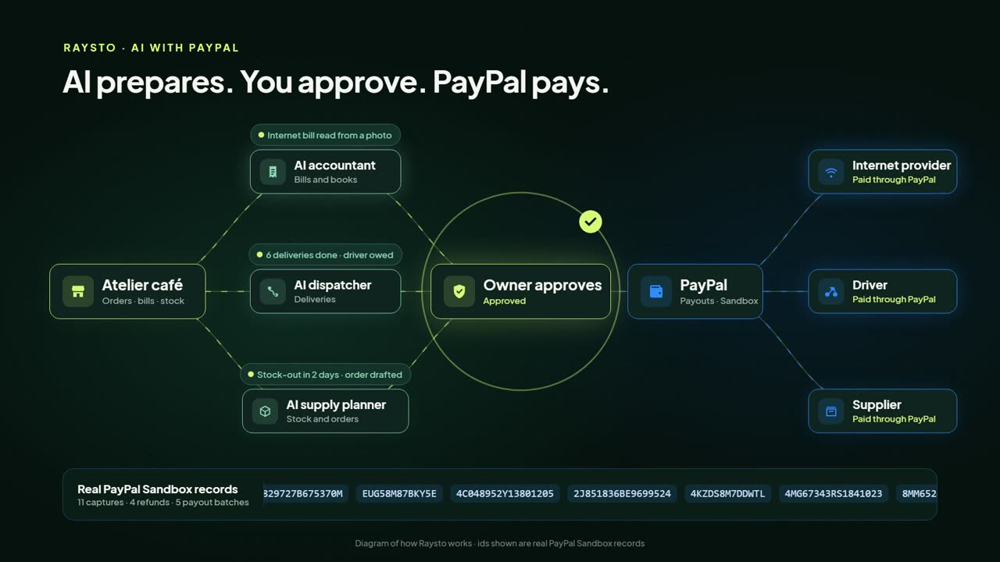

<h1 align="center">Raysto</h1>

<strong>The AI operating system for restaurants.</strong> AI prepares the work, you approve it, and PayPal moves the money.

<a href="https://rays.to"><strong>Enter the live demo</strong></a> · <a href="https://rays.to/raysto.apk">Android app</a> · <a href="docs/technical-overview.md">Technical overview</a>

**6 November 2026 — deployed 0.17 design candidate:** the web owner workspace now has focused investigation views, contextual evidence, revised navigation and responsive motion. Backend and console are `0.17.0-dev.6`; Android is the development-signed `0.17.0-dev.3+2203` with physical review deferred. [Current acceptance and open gates](docs/design-experience/acceptance.md) · [exact release manifest](docs/release-0.17-manifest.json) · [published artifacts and checksums](https://github.com/FouadABT/raysto/releases/tag/raysto-0.17-design-dev6). This is a development candidate, not an accepted submission or a guaranteed score.

## What Raysto is

A café or small restaurant runs on a till, paper tickets, a card terminal and a shoebox of bills, and the owner does the money work at night: paying bills, settling complaints, paying the team, chasing what customers owe. Raysto puts ordering, the kitchen, the team and the books in one system, and gives the owner **AI coworkers** that do that money work for them.

AI coworkers prepare evidence and proposals. Financial actions use the existing identity checks and permissions. Owners can enable bounded automatic refunds and known recurring bill payments; those policies must be identified when enabled. New pricing actions and the 0.17 guided judge journey require manual review.

## What it does for a café

- **Pays your bills.** Snap an electricity, water or supplier bill. The AI accountant reads the vendor, amount and due date, checks it was not paid before, and pays it with **PayPal Payouts** once you approve.
- **Settles complaints.** A guest says a dish was missing. The complaints agent checks the order and the PayPal payment and proposes a fair partial refund; **PayPal refunds** it.
- **Pays your team.** Tips and wages from the week's shifts are worked out and sent in one **PayPal Payouts** batch after your identity check.
- **Gets you paid.** A pay link and QR code for a deposit or an unpaid order: the customer pays with **PayPal checkout** and the books update by themselves.

Around those sit the rest of a café's day: guests ordering in one sentence and splitting the bill so each pays their own share with PayPal, voice orders at the counter, the kitchen board, shifts, double-entry books with profit and loss and VAT, supplies with stock-out forecasts, delivery with drivers and a partner API, several venues under one owner, analytics on AG Grid and AG Studio, and each restaurant connecting its own PayPal account. About fourteen AI coworkers in all, each with only its own tools: [the full list](docs/technical-overview.md#the-ai-coworkers).

## Try it

- Open **[rays.to](https://rays.to)** and press **Enter the live demo**. You land in a demo café's owner console, already signed in. Nothing to install.
- On Android, install **[rays.to/raysto.apk](https://rays.to/raysto.apk)** and tap **Sign in as a diner** or **Sign in as the café manager**.
- PayPal asks for a buyer login on its own page when you approve a payment; it is in the Devpost testing instructions.
- The demo café uses sample data and PayPal Sandbox, so no real money moves. It starts fresh every day at 09:00 UTC.

## How PayPal and AI work together

- **PayPal:** Orders v2 checkout, frozen split amounts, refunds, Payouts, pay links and verified webhooks. Existing MCP read tools are used where authorized. Invoicing and Transaction Search are not enabled on the current Sandbox app and are outside the required journey.
- **AI:** Google Gemini with function calling, vision for bills, menus and delivery notes, voice for counter orders and image generation for dish photos. Money decisions rest on fixed rules and real numbers; the AI reads, explains, drafts and proposes.
- **Safety:** agents act through an identity that can read and propose, never move money. Payouts and PayPal's executing tools run only from an approved action. [How each PayPal product is used](docs/technical-overview.md#how-paypal-is-used).

**Built with:** PayPal (Orders v2, Payouts, refunds, MCP server), Google Gemini, AG Grid and AG Studio, Flutter, Next.js and React, Serverpod and PostgreSQL on AWS, Firebase Authentication, OpenStreetMap.

## Proof

- **PayPal Sandbox runs on production**, 31 October to 4 November: Fourteen captures, six refunds and eight Payouts batches, each with its PayPal id ([0.16 run](docs/sandbox-run-0160.md), [earlier runs](docs/paypal-acceptance-2026-10-31.md)).
- **6 November design candidate:** [actual document → reviewed price → USD 9.70 collection → USD 11 supplier payout](docs/design-experience/integrated-sandbox-design-dev6-20261106.json), with genuine Sandbox references and explicit legacy accounting limits. [Actual-model and private owner layout check](docs/design-experience/live-workspace.json).
- **Historical AI evaluation**, 12 of 12 cases: [ai-evaluation-results.md](docs/ai-evaluation-results.md). This does not establish the new 0.17 financial model's accuracy; its [30 authored cases](docs/evaluation-0.17-cases.json) require a separately recorded run.
- **Validation:** historical release counts and current candidate checks are separate. Consult the [0.17 status](docs/design-experience/acceptance.md) and its dated manifest for current results and failures; local tests do not establish deployment, provider acceptance or a restaurant pilot.
- **Not covered yet**: a real restaurant, live PayPal, iOS, and a real Sandbox invoice or dispute (both features await enablement on the Sandbox app).

Raysto was started on 24 October 2026, inside the hackathon's submission period; the first commit (26 October) holds its first two days of work, and every change since is in the history.

## Learn more

[Technical overview](docs/technical-overview.md) · [Build it yourself](docs/getting-started.md) · [API contracts](docs/backend-v2/integration.md) · [All docs](docs/README.md)

| Path | Contents |
|---|---|
| [`lib/`](lib/) | Flutter app: diner, staff and courier |
| [`backend/raysto/`](backend/raysto/) | Serverpod server: agents, PayPal, ledger, migrations |
| [`web/`](web/) | Owner console (`ops.rays.to`) and the product page (`rays.to`) |
| [`video/`](video/) | The film and motion scenes (Remotion) |

MIT ([LICENSE](LICENSE)). Fonts, photographs and dependencies keep their own terms ([THIRD_PARTY_NOTICES.md](THIRD_PARTY_NOTICES.md)). Report vulnerabilities through [private security reporting](https://github.com/FouadABT/raysto/security/advisories/new). No affiliation with or endorsement by PayPal, Google or AG Grid is implied.
