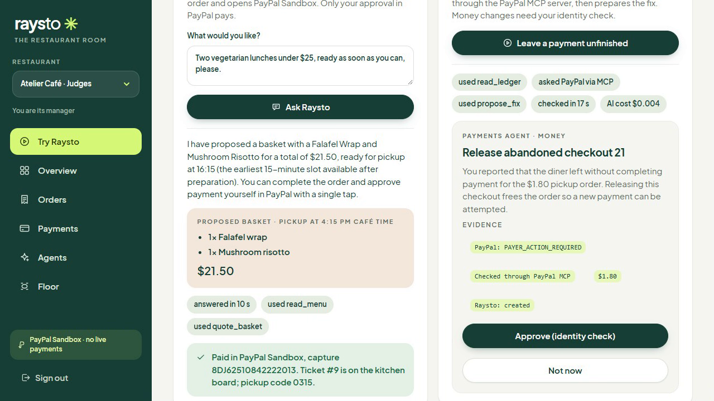
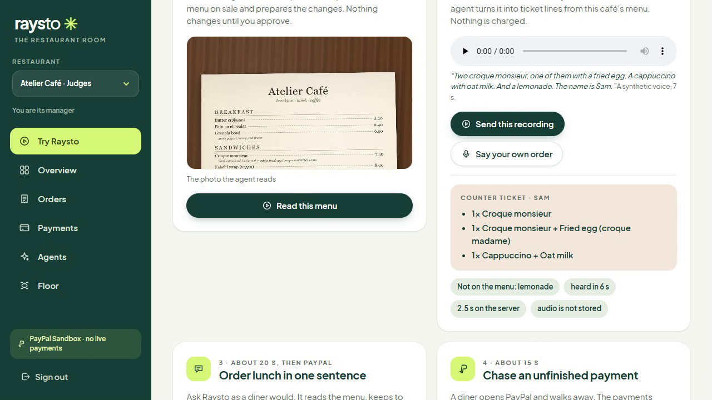
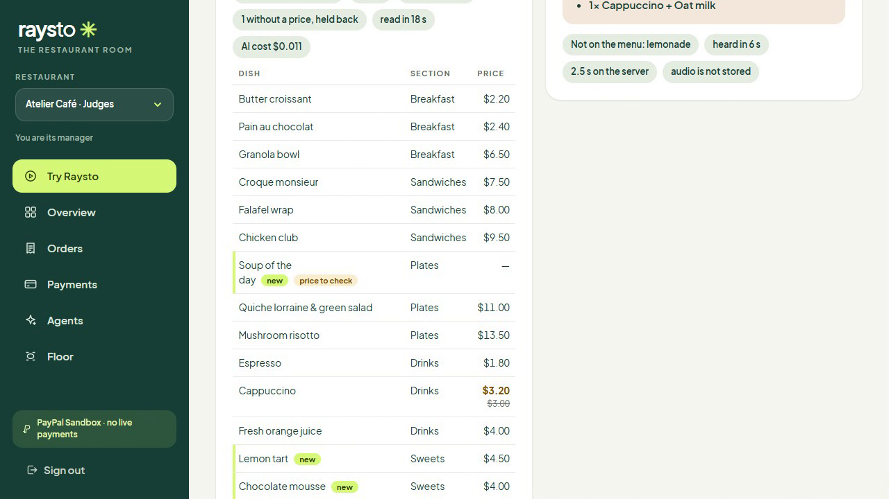
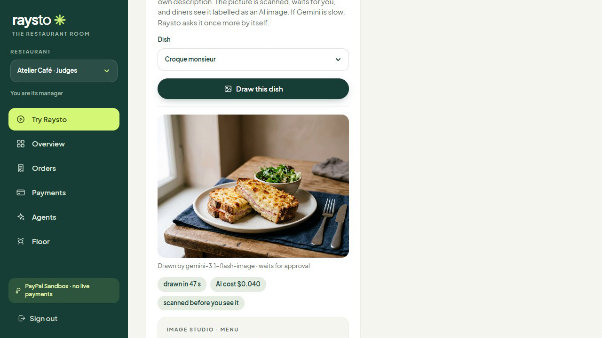
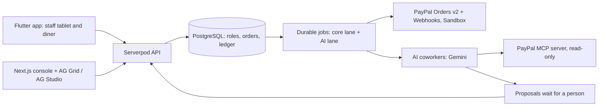

<h1 align="center">Raysto</h1>

<strong>AI coworkers run the café's money. You approve. PayPal moves it.</strong>

The till, kitchen board, ordering app and back office for a small restaurant, built for the <a href="https://paypalaihackathon.devpost.com/">PayPal AI Hackathon</a>.

The live console on 2 November: a one-sentence order paid in PayPal Sandbox (left), and the payments agent's proposal with PayPal's own status, read through the PayPal MCP server, waiting for approval (right).

**Watch the film (2 min 25 s): [rays.to/demo.mp4](https://rays.to/demo.mp4)**, recorded on the live judges' path on 2 November. It predates the eight money agents added on 3 November; a new cut is coming.

## Try it in two minutes

**Open [rays.to](https://rays.to)** and press **Try it now**. You land in the owner console of a demo café, already signed in as its manager, on a page of nine live demos, money first. Nothing to install, no form to fill. Times are from the run on production on 3 November.

| Demo | What you see | Time |
|---|---|---|
| 1. Close the day | The close agent matches PayPal's transaction list to the till and the kitchen, explains every gap, and waits for your sign-off. Until Transaction Search is enabled on the Sandbox app it reconciles from Raysto's own ledger and says so | about 15 s |
| 2. Pay the team | The payroll agent turns this week's clocked shifts into wages and splits the tip pool; after your identity check PayPal Payouts sends the batch and its id is kept | about 10 s, then PayPal |
| 3. Bill the caterer | "Lunch for 12 on Friday, budget $150" becomes a priced quote with a deposit; after your identity check PayPal Invoicing sends it with a QR code (Invoicing is still being enabled on the Sandbox app; the card says so) | about 15 s, then PayPal |
| 4. Settle a complaint | "My croissant was missing": the complaints agent reads the kitchen ticket and PayPal's capture through MCP, proposes a full, partial or no refund; PayPal refunds after your identity check | about 15 s, then PayPal |
| 5. Chase an unfinished payment | A diner walks away from PayPal; the payments agent asks PayPal itself through the PayPal MCP server and drafts the release | about 15 s |
| 6. Order lunch in one sentence | Ask Raysto for "two vegetarian lunches under $25"; it proposes a basket, one tap places the order and opens PayPal Sandbox, the kitchen gets the ticket | about 10 s, then PayPal |
| 7. Read a printed menu | The menu agent reads 14 dishes and prices off a photo, shows what is new and what changed, and waits for your approval | about 20 s |
| 8. Take an order by voice | A spoken counter order becomes ticket lines from the café's menu; record your own voice if you like | about 5 s |
| 9. Draw a dish for the menu | Gemini draws a photo of a dish; it is scanned, waits for you, and diners see it labelled as an AI image | about 50 s |

**Logins** (everything is PayPal Sandbox, so these are public):

| Where | Email | Password |
|---|---|---|
| [Owner console](https://ops.rays.to/ops?judge=1), manager of the demo café | `judge@rays.to` | `ginger-cocoa-latte-95` |
| Android app, a diner | `diner@rays.to` | `vanilla-basil-brioche-18` |
| PayPal Sandbox buyer (PayPal's own approval page) | in the Devpost testing instructions | |

The demo café starts fresh every day at 09:00 UTC and tidies finished demo orders every hour; its manager cannot rename it, change its team or take it offline. The console alone is enough to judge Raysto; the Android app is a direct download at **[rays.to/raysto.apk](https://rays.to/raysto.apk)** (its checksum and install steps are on [rays.to](https://rays.to)). The APK is 0.15.0 (4 November): the Today screen, kitchen tickets you drag between lanes, the Shifts tab, the tip step before PayPal and the complaint sheet.

## What Raysto is

A snack bar or small restaurant runs on a till, paper tickets and a card terminal that do not talk to each other, and the owner closes the day, pays the team, bills the caterer and settles complaints by hand. Raysto puts the counter, the kitchen board, pickup and table ordering, split bills, shifts, stock, expenses and the owner's back office on one backend, takes every payment through PayPal, and gives the owner AI coworkers that decide the money matters and prepare them: closing the day against PayPal's own ledger, splitting tips and paying the team, invoicing a catering request, deciding a refund, reading a delivery note or a receipt, as well as reading a menu into the system, taking a spoken order and drawing dish photos.

The one rule: **an AI coworker prepares a change with its evidence; a person approves it; only then does PayPal move the money.** Money changes also need the person to confirm it is really them. The owner can set small limits (`autonomy`: refunds up to an amount, a few a day, automatic invoice reminders) inside which an agent acts by itself and shows the PayPal id it got; payouts and invoice sends are never automatic.

## The AI coworkers

Fourteen coworkers, each with only its own tools. The eight money agents were added on 3 November; their first live run on production is in session 6 of the [acceptance notes](docs/paypal-acceptance-2026-10-31.md).

| Coworker | What it does | Its tools | What a person approves | PayPal executes | Recorded live |
|---|---|---|---|---|---|
| **Close agent** | Reconciles the day: PayPal's transaction list against the till, cash, tips, refunds and unpaid tickets; explains every gap and proposes the fix | `read_day`, `read_paypal_day` (MCP `list_transactions`, then REST Transaction Search), `propose_close` | The sign-off, and a reconcile for a capture Raysto missed | Transactions (read) | 13 s, signed; PayPal's list not yet enabled on the Sandbox app, so the close said so and used the ledger |
| **Payroll agent** | Turns clocked shifts into wages and splits the tip pool by hours and role into one batch | `read_week`, `propose_pay` | Sending the batch, with an identity check | **Payouts** `/v1/payments/payouts` | 10 s; batch `EUG58M87BKY5E`, $448.00 wages, pending at creation |
| **Catering agent** | Prices a one-sentence request from the menu, with a deposit and due date, drafts the invoice; reminds when overdue; a paid invoice becomes a kitchen order | `read_request`, `read_menu`, `propose_quote` | Sending the invoice, with an identity check | **Invoicing** via MCP (`create_invoice`, `send_invoice`, `generate_invoice_qr_code`, `send_invoice_reminder`); `INVOICING.INVOICE.PAID` webhook | Quote in 16 s; the send was refused because Invoicing is not yet enabled on the Sandbox app |
| **Complaints agent** | Reads the complaint, the kitchen ticket and PayPal's capture, proposes a full, partial or no refund with its reasons | `read_complaint`, `read_payment` (PayPal MCP), `propose_remedy` | The refund, with an identity check; within the owner's limit it refunds by itself | **Refunds** | 16 s; the seeded complaint named a dish the order lacked, so no refund was proposed (fixed in 0.14.1) |
| **Disputes agent** | Lists and reads disputes, assembles the evidence (ticket, pickup code, timeline) and drafts the reply; accepts only when the café is wrong | `read_dispute` (MCP `get_dispute`), `propose_response` | Accepting a claim | **Disputes** via MCP (`list_disputes`, `get_dispute`, `accept_dispute_claim`) | The judges' café holds a seeded case, labelled seeded; no real Sandbox dispute yet |
| **Supplies agent** | Reads a photographed delivery note into lines and prices, matches stock, proposes stock in and the supplier's payment | Gemini vision, `read_stock`, `read_suppliers`, `propose_delivery` | Stock in, and the payout | **Payouts** to the supplier | Integration test on the sample note (8 lines, $479.80); not yet run on production |
| **Expenses agent** | Reads a receipt into merchant, category, amount and VAT and matches it to PayPal's transactions | Gemini vision, `read_paypal_transactions`, `propose_expense` | Recording the expense | Transactions (read) | Integration test on the sample receipt ($79.56); not yet run on production |
| **Loyalty agent** | Tags regulars and lapsed customers from paid orders and proposes one coupon with its cost | `read_customers`, `propose_coupon` | Creating the coupon | Coupon redeemed at **Orders** checkout | Ran on the judges' café: a coupon proposal waits in the inbox |
| **Copilot** | Notices a kitchen running late and proposes a new preparation time; proposes next week's roster from sales by hour | `read_kitchen`, `propose_preparation_time`, `read_demand`, `propose_roster` | The new preparation time; the roster | Hours feed the pay run | Ran live on 1 November; the roster is covered by tests |
| **Menu agent** | Reads photos of a printed menu into dishes, sections, prices and options; never guesses a price | Gemini vision, then an organising call | Publishing the merged menu | The menu PayPal charges from | 14 of 14 dishes, 19 s, $0.012 (3 November) |
| **Counter voice** | Hears a spoken order at the till and fills the ticket with real dishes and options | Gemini audio with the counter menu | The cashier checks the lines and takes payment as usual | Counter QR | 3.5 s (3 November) |
| **Takeaway assistant** (Ask Raysto) | Builds a priced pickup basket from one sentence, keeps to a budget and a pickup time | `read_menu`, `quote_basket`, `payment_status` | The basket, then the payment on PayPal's page | **Orders v2** | 9.6 s → capture `8L994373M64657007`, ticket #14 (3 November) |
| **Payments agent** | Investigates stuck or abandoned PayPal checkouts, explains them, prepares the fix | `read_ledger`, `read_paypal` (PayPal MCP) | Releasing or recording a payment, with an identity check | Orders (read via MCP), release | 17 s via MCP (3 November) |
| **Image studio** | Draws a photo of a dish from its own description, with an empty background | Gemini `gemini-3.1-flash-image` (OpenAI `gpt-image-1` when a key is set) | Putting the photo on the menu, labelled as AI | — | 52.7 s, $0.04 (3 November) |

Counter voice, the menu agent and the image studio on the live console, 2 November.

AI spending has hard caps: a hackathon budget split by feature, and $5 per restaurant per day. Each agent has its own kill switch.

## How PayPal is used

- **Orders v2** for every online payment: create, buyer approval on PayPal's page, then a single server-side capture. A capture lease means nothing is captured twice; the verified webhook, a reconciliation job and the buyer's return all lead to the same settle step.
- **Payouts** (`/v1/payments/payouts`) for wages, tips and supplier payments, as one batch per pay run, sent only after the owner's identity check; the batch and item ids are kept and polled to completion.
- **Invoicing** through the PayPal MCP server for catering: create, send, QR code and reminder, each only after approval; `INVOICING.INVOICE.PAID` turns the invoice into a kitchen order.
- **Transaction Search** for the daily close and expense matching (read only).
- **Disputes** through the MCP server: list and read for the evidence pack, accept only after approval.
- **Refunds**, partial or full, credited to the right order, behind a fresh identity check; small ones inside the owner's limit are made by the complaints agent itself.
- **Verified webhooks** (`CHECKOUT.ORDER.APPROVED`, `PAYMENT.CAPTURE.COMPLETED`, `PAYMENT.CAPTURE.REFUNDED`, `INVOICING.INVOICE.PAID`, `INVOICING.INVOICE.CANCELLED`, `CUSTOMER.DISPUTE.CREATED`, `CUSTOMER.DISPUTE.RESOLVED`), each processed exactly once.
- **Counter QR**: the customer pays the counter sale on their own phone; once paid the ticket goes to the kitchen.
- **Exact split bills**: each diner pays their own share as its own PayPal order, tied to a frozen split plan, to the cent.
- **PayPal MCP server** (`@paypal/mcp` 1.8.1 over stdio) started with exactly twelve tools: seven reads the model may call (`get_order`, `get_refund`, `list_transactions`, `list_invoices`, `get_invoice`, `list_disputes`, `get_dispute`) and five executes (`create_invoice`, `send_invoice`, `send_invoice_reminder`, `generate_invoice_qr_code`, `accept_dispute_claim`) that only the approval path can run; the model never sees them.
- **PayPal's page names the restaurant** (`brand_name`), with no shipping step and a "Pay now" button.
- **Sandbox only** for the hackathon, on one Sandbox business account. Payouts works there; Transaction Search and Invoicing are being enabled on the Sandbox app (PayPal answered `NOT_AUTHORIZED` on 3 November), and the console says so where it matters. Each restaurant connecting its own PayPal account is built (`merchant.connect`, PayPal Partner Referrals, the restaurant as payee); going live needs PayPal to approve Raysto as a platform partner.

## Tools used, and how

| Tool | How Raysto uses it |
|---|---|
| PayPal Orders v2 and Webhooks | Checkout, capture, refunds, verified events, invoice and dispute events (Sandbox) |
| PayPal Payouts | Wages, tips and supplier payments after approval |
| PayPal Invoicing, Transaction Search, Disputes | Catering invoices, the daily close and expense matching, dispute evidence and acceptance |
| PayPal MCP server `@paypal/mcp` 1.8.1 | Seven reads for the agents and Ask Raysto, five executes behind approval, over stdio |
| Google Gemini 3.6 Flash (Developer API) | Function calling for the fourteen coworkers and Ask Raysto; vision for menus, delivery notes and receipts; audio for counter orders |
| Gemini `gemini-3.1-flash-image` | Dish photos in the image studio |
| AG Grid and AG Studio | Owner console grids (Orders, Payments, Money, Team), the Floor section's studio with three custom widgets |
| Firebase Authentication | Google and email sign-in; the backend checks verified email |
| Serverpod 4, PostgreSQL | Backend, roles, ledger, durable jobs, on AWS at `api.rays.to` |
| Flutter | Android staff tablet (counter, kitchen, orders, shifts, agents) and diner app |
| Next.js 16, React 19 | Owner console at `ops.rays.to` and this judges' page at `rays.to` |
| Kokoro TTS, Remotion | Synthetic voices for the voice evaluation, and the demo video |

## Evidence

- **Live PayPal Sandbox runs**, 31 October to 4 November: pickup, counter QR, a two-buyer split bill, a partial refund, the one-sentence order, the payments agent's release, and on 3 and 4 November the nine-card judge path with real Payouts batches and complaint refunds. Eleven captures, four refunds and five Payouts batches, with ids: [paypal-acceptance-2026-10-31.md](docs/paypal-acceptance-2026-10-31.md).
- **Live AI evaluation, 12 of 12**: 3 menus, 5 spoken orders, 4 takeaway requests against production: [ai-evaluation-results.md](docs/ai-evaluation-results.md). Inputs were rendered images and synthetic voices.
- **Tests**: backend 68 unit tests and 122 integration tests on an isolated database (run serially); console 83 unit tests and 31 browser tests; app 211 widget tests, all passing on 4 November.
- **Neutral audit** against the judging criteria: [raysto-hackathon-audit-2026-11-02.md](docs/audits/raysto-hackathon-audit-2026-11-02.md) (scored before the money agents).

Not covered: a real restaurant, live (non-Sandbox) PayPal, iOS, a person speaking at a real counter, a real Sandbox invoice or dispute (the two features await enablement), and the supplies and expenses agents on production.

## Built during the hackathon

Raysto was started on 24 October 2026, inside the submission period. The first commit (26 October) holds its first two days of work; every change since is in the history. The PayPal checkout, split bills and refunds came first; the AI coworkers, voice ordering, the one-tap PayPal order, the image studio, the console and tablet redesign and this judges' path were added from 30 October on; the back office with its eight money agents, PayPal Payouts, Invoicing and disputes on 3 November.

## Architecture

PostgreSQL owns permissions, prices, orders, payments, shifts, payouts, invoices, stock and expenses. Agents act through a service identity that can read and propose, never run a command; the five MCP executes and the Payouts call run only from an approved action. [API contracts](docs/backend-v2/integration.md) · [System maps](docs/backend-v2/README.md) · [Back-office design](docs/back-office-design.md)

## Run it yourself

The judges' path above needs nothing installed. To build from source (Flutter 3.47.8 / Dart 3.13.7, Node 24), see [getting-started.md](docs/getting-started.md); running your own backend needs your own Firebase project, PayPal Sandbox app and Gemini key.

## Repository map

| Path | Contents |
|---|---|
| [`lib/`](lib/) | Flutter app: staff tablet, diner app, design system, and a separate offline design preview |
| [`backend/raysto/`](backend/raysto/) | Serverpod server (agents in `lib/src/platform/agent_*.dart`, back-office records in `backoffice.dart`), client and migrations |
| [`web/`](web/) | Owner console (`/ops`: Overview, Orders, Payments, Agents, Money, Team, Floor) and judges' page (`/judges`) |
| [`tool/`](tool/) | Live evaluation (`ai_eval.cjs`), the judges' café setup and review renders |
| [`docs/`](docs/README.md) | Reviewer guide, Devpost text, evidence, audit, setup and contracts |
| [`video/`](video/) | The demo video project (Remotion) |

## Licence and security

MIT ([LICENSE](LICENSE)). Fonts, photographs and dependencies keep their own terms ([THIRD_PARTY_NOTICES.md](THIRD_PARTY_NOTICES.md)). Report vulnerabilities through [private security reporting](https://github.com/FouadABT/raysto/security/advisories/new). No affiliation with or endorsement by PayPal, Google or AG Grid is implied.
