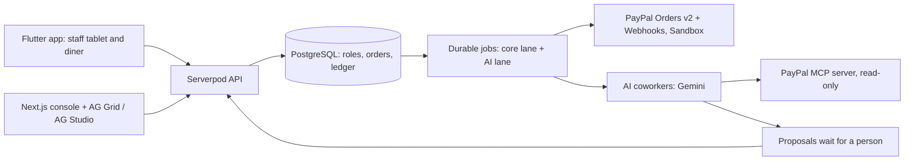

<h1 align="center">Raysto</h1>

<strong>AI coworkers prepare. You approve. PayPal moves the money.</strong>

The till, kitchen board, ordering app and back office for a small restaurant, built for the <a href="https://paypalaihackathon.devpost.com/">PayPal AI Hackathon</a>.

## Try it in two minutes

**Open [rays.to](https://rays.to)** and press **Try it now**. You land in the owner console of a demo café, already signed in as its manager, on a page of five live demos. Nothing to install, no form to fill.

| Demo | What you see | Time |
|---|---|---|
| 1. Read a printed menu | The menu agent reads 14 dishes and prices off a photo, shows what is new and what changed, and waits for your approval | about 20 s |
| 2. Take an order by voice | A spoken counter order becomes ticket lines from the café's menu; record your own voice if you like | about 5 s |
| 3. Order lunch in one sentence | Ask Raysto for "two vegetarian lunches under $25"; it proposes a basket, one tap places the order, you approve in PayPal Sandbox, the kitchen gets the ticket | about 20 s, then PayPal |
| 4. Chase an unfinished payment | A diner walks away from PayPal; the payments agent asks PayPal itself through the PayPal MCP server and drafts the release | about 15 s |
| 5. Draw a dish for the menu | Gemini draws a photo of a dish; it is scanned, waits for you, and diners see it labelled as an AI image | about 45 s |

**Logins** (everything is PayPal Sandbox, so these are public):

| Where | Email | Password |
|---|---|---|
| [Owner console](https://ops.rays.to/ops?judge=1), manager of the demo café | `judge@rays.to` | `ginger-cocoa-latte-95` |
| Android app, a diner | `diner@rays.to` | `vanilla-basil-brioche-18` |
| PayPal Sandbox buyer (PayPal's own approval page) | in the Devpost testing instructions | |

The demo café starts fresh every day at 09:00 UTC; its manager cannot rename it, change its team or take it offline. The Android app is on the [releases page](https://github.com/FouadABT/raysto/releases); the console alone is enough to judge Raysto.

## What Raysto is

A snack bar or small restaurant runs on a till, paper tickets and a card terminal that do not talk to each other. Raysto puts the counter, the kitchen board, pickup and table ordering, split bills and the owner's back office on one backend, takes every payment through PayPal, and adds AI coworkers that do the tedious parts: reading a menu into the system, taking a spoken order, chasing a payment that never finished, drawing dish photos, watching kitchen lateness.

The one rule: **an AI coworker prepares a change with its evidence; a person approves it; only then does it run.** Money changes also need the person to confirm it is really them. The AI never captures, refunds or marks anything paid.

## The AI coworkers

| Coworker | What it does | Its tools | What a person approves | Recorded live |
|---|---|---|---|---|
| **Menu agent** | Reads photos of a printed menu into dishes, sections, prices and options; never guesses a price | Gemini vision, then an organising call | Publishing the merged menu | 14 of 14 dishes and prices, 18 s, $0.013 |
| **Counter voice** | Hears a spoken order at the till and fills the ticket with real dishes and options | Gemini audio with the counter menu | The cashier checks the lines and takes payment as usual | 5 of 5 spoken orders in the evaluation |
| **Takeaway assistant** (Ask Raysto) | Builds a priced pickup basket from one sentence, keeps to a budget and a pickup time | `read_menu`, `quote_basket`, `payment_status` | The basket, then the payment on PayPal's page | Sentence → order 7 → capture `9BY842216S6346205` |
| **Payments agent** | Investigates stuck or abandoned PayPal checkouts, explains them, prepares the fix | `read_ledger`, `read_paypal` (PayPal MCP) | Releasing or recording a payment, with an identity check | Checkout 10 released after a PayPal MCP read |
| **Copilot** | Notices a kitchen running late and proposes a longer promised time, then a shorter one when calm | `read_kitchen`, `propose_preparation_time` | The new preparation time | Ran live on 1 November; its first cards were false alarms from a scheduled order, fixed the same night |
| **Image studio** | Draws a photo of a dish from its own description, with an empty background | Gemini `gemini-3.1-flash-image` (OpenAI `gpt-image-1` when a key is set) | Putting the photo on the menu, labelled as AI | Photo scanned and approved, 44 s, $0.04 |

AI spending has hard caps: a hackathon budget split by feature, and $5 per restaurant per day. Each agent has its own kill switch.

## How PayPal is used

- **Orders v2** for every online payment: create, buyer approval on PayPal's page, then a single server-side capture. A capture lease means nothing is captured twice; the verified webhook, a reconciliation job and the buyer's return all lead to the same settle step.
- **Verified webhooks** (`CHECKOUT.ORDER.APPROVED`, `PAYMENT.CAPTURE.COMPLETED`, `PAYMENT.CAPTURE.REFUNDED`), each processed exactly once.
- **Counter QR**: the customer pays the counter sale on their own phone; once paid the ticket goes to the kitchen.
- **Exact split bills**: each diner pays their own share as its own PayPal order, tied to a frozen split plan, to the cent.
- **Partial refunds** credited to the right order, behind a fresh identity check.
- **PayPal MCP server** (`@paypal/mcp` over stdio) inside the payments agent and Ask Raysto: the AI reads PayPal's own record of a payment, and its answer names the source.
- **Sandbox only** for the hackathon, on one Sandbox business account.

## Tools used, and how

| Tool | How Raysto uses it |
|---|---|
| PayPal Orders v2 and Webhooks | Checkout, capture, refunds, verified events (Sandbox) |
| PayPal MCP server `@paypal/mcp` 1.8.1 | Read-only PayPal lookups by the payments agent and Ask Raysto, over stdio |
| Google Gemini 3.6 Flash (Developer API) | Function calling for the agents and Ask Raysto; vision for menus; audio for counter orders |
| Gemini `gemini-3.1-flash-image` | Dish photos in the image studio |
| AG Grid and AG Studio | Owner console grids, and the Floor section's studio with three custom widgets |
| Firebase Authentication | Google and email sign-in; the backend checks verified email |
| Serverpod 4, PostgreSQL | Backend, roles, ledger, durable jobs, on AWS at `api.rays.to` |
| Flutter | Android staff tablet (counter, kitchen, orders, agents) and diner app |
| Next.js 16, React 19 | Owner console at `ops.rays.to` and this judges' page at `rays.to` |
| Kokoro TTS, Remotion | Synthetic voices for the voice evaluation, and the demo video |

## Evidence

- **Live PayPal Sandbox runs**, 31 October to 2 November: pickup, counter QR, a two-buyer split bill, a partial refund, the one-sentence order, the payments agent's release. Six captures and a refund, with ids: [paypal-acceptance-2026-10-31.md](docs/paypal-acceptance-2026-10-31.md).
- **Live AI evaluation, 12 of 12**: 3 menus, 5 spoken orders, 4 takeaway requests against production: [ai-evaluation-results.md](docs/ai-evaluation-results.md). Inputs were rendered images and synthetic voices.
- **Tests**: backend 85 integration tests on an isolated database and 60 unit tests; console 21 unit tests; app 145 widget tests (3 older offline-demo layout tests fail and are listed in the audit).
- **Neutral audit** against the judging criteria: [raysto-hackathon-audit-2026-11-02.md](docs/audits/raysto-hackathon-audit-2026-11-02.md).

Not covered: a real restaurant, live (non-Sandbox) PayPal, iOS, and a person speaking at a real counter.

## Built during the hackathon

Raysto was started on 24 October 2026, inside the submission period. The first commit (26 October) holds its first two days of work; every change since is in the history. The PayPal checkout, split bills and refunds came first; the AI coworkers, voice ordering, the one-tap PayPal order, the image studio, the console and tablet redesign and this judges' path were added from 30 October on.

## Architecture

PostgreSQL owns permissions, prices, orders and payments. Agents act through a service identity that can read and propose, never run a command. [API contracts](docs/backend-v2/integration.md) · [System maps](docs/backend-v2/README.md)

## Run it yourself

The judges' path above needs nothing installed. To build from source (Flutter 3.47.8 / Dart 3.13.7, Node 24), see [getting-started.md](docs/getting-started.md); running your own backend needs your own Firebase project, PayPal Sandbox app and Gemini key.

## Repository map

| Path | Contents |
|---|---|
| [`lib/`](lib/) | Flutter app: staff tablet, diner app, design system, and a separate offline design preview |
| [`backend/raysto/`](backend/raysto/) | Serverpod server (agents in `lib/src/platform/agent_*.dart`), client and migrations |
| [`web/`](web/) | Owner console (`/ops`) and judges' page (`/judges`) |
| [`tool/`](tool/) | Live evaluation (`ai_eval.cjs`), the judges' café setup and review renders |
| [`docs/`](docs/README.md) | Reviewer guide, Devpost text, evidence, audit, setup and contracts |
| [`video/`](video/) | The demo video project (Remotion) |

## Licence and security

MIT ([LICENSE](LICENSE)). Fonts, photographs and dependencies keep their own terms ([THIRD_PARTY_NOTICES.md](THIRD_PARTY_NOTICES.md)). Report vulnerabilities through [private security reporting](https://github.com/FouadABT/raysto/security/advisories/new). No affiliation with or endorsement by PayPal, Google or AG Grid is implied.
