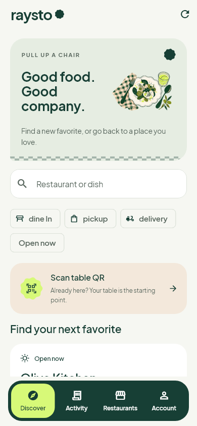
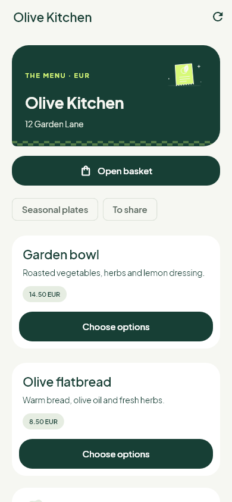
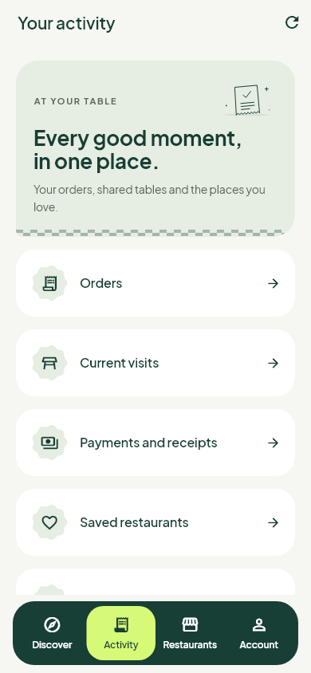
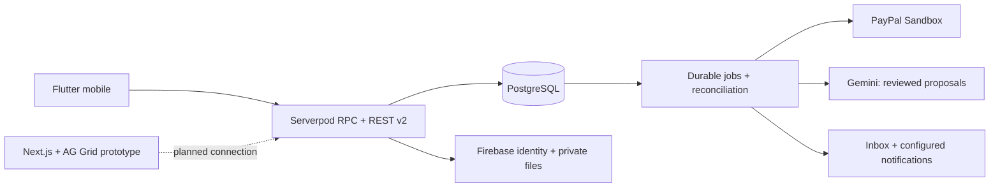

<p align="center"></p>
<h1 align="center">Raysto</h1>
<p align="center"><strong>Good company. Thoughtful ordering. A clearer bill.</strong></p>
<p align="center">Flutter mobile · Serverpod + PostgreSQL · Firebase · Gemini · PayPal Sandbox</p>
<p align="center"><a href="docs/reviewer-guide.md">Reviewer guide</a> · <a href="docs/getting-started.md">Run locally</a> · <a href="docs/project-status.md">What works today</a> · <a href="docs/conversation-roadmap.md">What's next</a></p>

Raysto brings restaurant discovery, ordering, table service and shared bills into one mobile experience. Diners review their choices; restaurant teams manage the same server-owned orders; AI suggests changes that people approve.

Built for the [PayPal AI Hackathon](https://paypalaihackathon.devpost.com/). This repository includes a connected mobile application and backend, an explicitly isolated offline demo, and a separate web prototype. The next product milestone is a shared table conversation with actionable order and payment cards.

## A place at the table

<p align="center">
  
  
  
</p>

Actual Flutter widget renders with illustrative fixtures. Screenshots demonstrate the interface, not a completed payment or live restaurant partnership. [Design and motion](docs/mobile-art-direction.md) · [Asset credits](docs/assets.md)

## Explore the project

| Experience | Current scope |
| --- | --- |
| **Diners** | Discovery, menus, baskets and quotes, dine-in visits, service requests, reservations, pickup/delivery, shared bills and history. |
| **Restaurant teams** | Restaurant/menu management, tables, kitchen tickets, couriers, invitations, reports and support. Permissions come from PostgreSQL memberships. |
| **Reviewed AI** | Gemini-backed menu extraction/generation, translation and recommendation proposals. Approval and publication are separate actions. |
| **Payments** | Server-side PayPal Sandbox checkout, allocations, reconciliation and refund source. Complete buyer approval/capture/refund acceptance remains a separate gate. |
| **Web prototype** | Next.js, React and AG Grid Community with browser-local fixtures. Backend connection and AG Studio are planned. |

**Status: development preview.** Mobile source is at `0.10.0+2012`; the latest recorded backend deployment is `0.9.4`. Selected integration checks are recorded; full real-device and PayPal buyer-to-refund acceptance are not yet complete. [Evidence and limitations](docs/project-status.md).

## Run the mobile preview

Use Flutter **3.47.8** / Dart **3.13.7**, an Android toolchain and an emulator or device. These are the recorded versions for this snapshot; dependency lockfiles are committed.

```sh
git clone https://github.com/FouadABT/raysto.git
cd raysto
flutter pub get
flutter run
```

Choose the explicit **offline demo** to explore fictional diners and restaurant roles without a server. Its AI, payments and staff accounts are simulated. Connected mode requires a configured backend, Firebase identity and an explicit API origin. The offline walkthrough is not proof of a PayPal transaction.

[Complete setup](docs/getting-started.md) covers Android prerequisites, backend/database configuration, Firebase, provider credentials and the web preview. iOS source is included; an iOS build has not been validated. Flutter web is not a target.

## Architecture



PostgreSQL owns permissions, prices, orders, occupancy and payment records. Firebase preferences and presence cannot grant business permissions. Provider redirects and chat messages cannot mark bills paid. [API contracts](docs/backend-v2/integration.md) · [OpenAPI](docs/backend-v2/openapi.json) · [Detailed system maps](docs/backend-v2/README.md)

## Repository map

| Path | Contents |
| --- | --- |
| [`lib/`](lib/) | Native Flutter application, design system, connected client and separate offline demo. |
| [`backend/raysto/`](backend/raysto/) | Serverpod server, generated Dart client and SQL migrations. |
| [`backend/operations/`](backend/operations/) | Required SQL supplements and configuration examples. |
| [`backend/sdk/typescript/`](backend/sdk/typescript/) | Generated client for the future connected web app. |
| [`web/`](web/) | Separate Next.js prototype; AG Grid Community is already included. |
| [`docs/`](docs/README.md) | Reviewer guide, setup, status, roadmap, contracts and design provenance. |
| [`test/`](test/) | Mobile tests; backend and web tests live beside their applications. |
| [`assets/`](assets/) · [`third_party/`](third_party/) | Artwork, fonts, fixtures and preserved third-party notices. |

Generated bindings and migrations are checked in. SDK installations, build outputs, private QA records, server keys and host-specific provisioning scripts are excluded.

## Contributing and security

Read [CONTRIBUTING.md](CONTRIBUTING.md) before changing domain rules or generated models. Report vulnerabilities through [private security reporting](https://github.com/FouadABT/raysto/security/advisories/new), following [SECURITY.md](SECURITY.md).

Original project code is available under the [MIT License](LICENSE). Fonts, stock photographs and dependencies retain their own terms; see [THIRD_PARTY_NOTICES.md](THIRD_PARTY_NOTICES.md). No affiliation or endorsement by PayPal, Google or AG Grid is implied.
